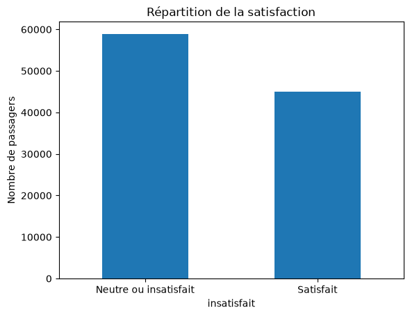
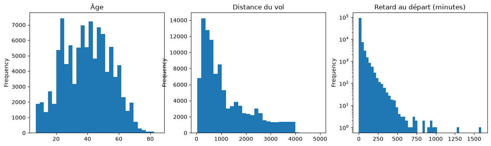

# Partie A : les données, l'exploration et la protection des données

# 2. Les données et l'exploration

## 2.1 Les données et leur nettoyage

L'enquête compte 103 904 passagers dans le fichier d'analyse. Pour chacun, on connaît son profil (âge, genre, fidélité), son vol (classe, motif, distance, retards), ses notes de 1 à 5 sur 14 services, et s'il s'est déclaré « satisfait » ou « neutre ou insatisfait ». Un second fichier de 25 976 passagers a été mis de côté sans être exploré : il sert uniquement à mesurer la performance du modèle final.

Le nettoyage s'est limité à trois corrections :

- Les notes égales à 0 signifient « pas de réponse » et non « très mauvais ». Preuve : parmi les 3 103 passagers ayant 0 au wifi, 99,7 % sont satisfaits. Ces 0 ont donc été traités comme des réponses manquantes.
- 310 retards à l'arrivée manquaient. Ils ont été remplacés par le retard au départ, presque identique (corrélation de 0,966).
- Les très gros retards (jusqu'à 1 592 minutes) ont été conservés : ce sont de vrais retards, pas des erreurs.

## 2.2 Qui sont les passagers mécontents

56,7 % des passagers ne sont pas satisfaits. Trois profils se détachent :

- Le motif du voyage compte le plus : 89,8 % de mécontents chez les voyageurs personnels, contre 41,7 % chez les voyageurs d'affaires.
- La classe : 81,4 % en Eco, 75,4 % en Eco Plus, 30,6 % en Business.
- La fidélité : 76,3 % chez les clients non fidèles, contre 52,3 % chez les fidèles.

En croisant classe et motif, on voit que la classe ne suffit pas : un voyageur personnel reste mécontent à 87,8 % même en Business. À l'inverse, pour les voyageurs d'affaires, la classe change tout (28,0 % en Business contre 70,4 % en Eco).

L'âge joue aussi : les moins de 18 ans (83,6 %) et les plus de 60 ans (79,2 %) sont les plus mécontents. Le retard a un effet réel mais limité : 52,7 % de mécontents sans retard, environ 64 % au-delà de 15 minutes.

## 2.3 Les limites des données

- Seuls les passagers ayant répondu à l'enquête sont connus, alors que le modèle sera appliqué à tous. Ceux qui répondent ne ressemblent pas forcément aux autres.
- La catégorie « neutre ou insatisfait » mélange des passagers simplement neutres et des passagers vraiment déçus.
- Ces données montrent des liens, pas des causes : un lien entre un service et la satisfaction ne prouve pas que l'améliorer rendra les passagers satisfaits.

# 6. Protection des données

## 6.1 Un nouvel usage des données

Le questionnaire a été collecté pour mesurer la satisfaction. L'utiliser pour signaler des passagers au personnel est un usage nouveau, d'autant que la plupart des passagers signalés n'auront jamais répondu. C'est un profilage au sens du RGPD, acceptable seulement sous conditions.

## 6.2 Les conditions pour que ce soit acceptable

- Base légale : l'intérêt légitime de la compagnie (art. 6.1.f). L'approche est une offre de service, sans conséquence négative pour le passager.
- Information : la politique de confidentialité, communiquée à la réservation, mentionne ce dispositif (art. 13).
- Droit de refuser : tout passager peut s'y opposer dans son espace client, ou décliner l'approche sur place (art. 21).
- Décision humaine : le modèle propose une liste, l'agent décide d'aborder ou non le passager.
- Analyse d'impact menée avant le lancement, avec le délégué à la protection des données (art. 35).
- Conservation courte : la liste est supprimée chaque soir, et le score n'est jamais ajouté au dossier client.

## 6.3 Le cas des enfants

Les données comptent 7 931 mineurs, mécontents à 83,6 %. Le RGPD leur accorde une protection renforcée face au profilage (considérant 38). Règle retenue : aucun mineur n'est signalé. S'il voyage accompagné, c'est l'adulte qui peut être approché.

## 6.4 Chaque information du modèle est-elle acceptable

- Classe, distance du vol, retards : oui. Ce sont des informations sur le billet et le vol, pas sur la personne.
- Client fidèle ou non : oui. C'est une donnée confiée par le client à la compagnie.
- Motif du voyage : oui, seulement s'il a été déclaré à la réservation, jamais deviné.
- Âge : oui, pour les adultes seulement. Il apporte 100 € de bénéfice pour 1 000 passagers.
- Genre : non. Il n'améliore pas le modèle (96,5 % de précision avec ou sans), donc le principe de minimisation impose de l'écarter.
- Notes du questionnaire : non. Elles sont inconnues à l'arrivée et serviraient à une autre fin que l'enquête.

## 6.5 Ce que voit l'agent sur un passager signalé

Seulement le nom, le numéro de siège, la porte d'arrivée, et la mention neutre « passager à accueillir en priorité ». Ni score, ni raison du signalement, ni âge. L'agent aborde le passager avec une question ouverte (« Comment s'est passé votre vol ? »), jamais avec un a priori.
