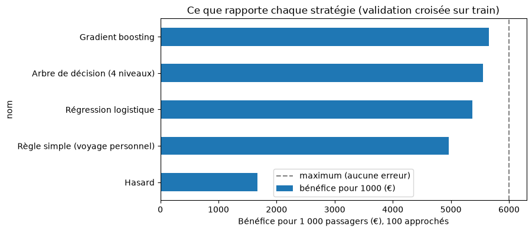

# Partie C : prédire les passagers mécontents

# 4. Qui approcher à l'atterrissage

## 4.1 La question et la bonne mesure

La compagnie veut approcher, dès l'atterrissage, les passagers qui risquent d'être mécontents. Elle ne peut en approcher que 10 %, soit 100 passagers sur 1 000. Il faut donc classer les passagers du plus au moins à risque, et approcher les 100 premiers.

Chaque approche coûte 40 €. Un mécontent sur trois ne revient pas (600 € perdus) et l'approche en récupère la moitié : approcher un vrai mécontent rapporte donc 100 €. Le bénéfice pour 1 000 passagers est :

**bénéfice = 100 × (100 × précision − 40)**

où la précision est la part de vrais mécontents parmi les 100 passagers approchés. L'approche est rentable dès 40 % de précision, et le maximum possible est de 6 000 €.

La bonne mesure n'est donc pas le pourcentage de bonnes réponses sur tous les passagers, mais **la précision sur les 10 % les mieux classés**, convertie en euros.

## 4.2 Ce que le modèle a le droit d'utiliser

Le modèle n'utilise que ce que la compagnie connaît au moment où l'avion atterrit :

| Information | D'où elle vient |
|---|---|
| Client fidèle ou non | programme de fidélité |
| Âge | dossier de réservation |
| Motif du voyage (affaires ou personnel) | déclaré à la réservation |
| Classe | billet |
| Distance du vol | vol |
| Retards au départ et à l'arrivée | mesurés par la compagnie |

Les 14 notes de service sont exclues : le questionnaire est rempli après le vol, et la plupart des passagers n'y répondent jamais. Le genre est exclu aussi : il n'améliore pas le modèle (section 4.4).

## 4.3 Comparer sans tricher

Le fichier de test a été mis de côté jusqu'à la toute fin. Pour comparer les stratégies, le fichier d'analyse a été coupé en 5 parts : on apprend sur 4, on mesure sur la 5e, et on recommence 5 fois. Chaque chiffre ci-dessous est la moyenne de ces 5 mesures. L'écart entre les 5 parts est partout inférieur à 0,01 : les résultats sont stables.

Deux stratégies sans modèle servent de points de comparaison : approcher au hasard, et la règle simple « approcher les voyageurs personnels ».

| Stratégie | Précision sur les 10 % approchés | Bénéfice pour 1 000 passagers | Gain sur la règle simple |
|---|---|---|---|
| Au hasard | 56,7 % | 1 667 € | −3 298 € |
| Règle simple : voyageurs personnels | 89,7 % | 4 965 € | 0 € |
| Régression logistique | 93,7 % | 5 367 € | +402 € |
| Arbre de décision (4 niveaux) | 95,5 % | 5 551 € | +586 € |
| Gradient boosting | 96,5 % | 5 653 € | +688 € |

La règle simple, sans aucun calcul, fait déjà presque tout le travail : elle atteint 4 965 € sur 6 000 € possibles. Les modèles ne se disputent que les 1 035 € restants. Le meilleur en récupère 688 €, soit environ 14 % de bénéfice en plus.

## 4.4 Faut-il l'âge ? le genre ?

| Version du modèle (gradient boosting) | Précision | Bénéfice pour 1 000 passagers |
|---|---|---|
| Modèle retenu | 96,5 % | 5 653 € |
| Sans l'âge | 95,5 % | 5 553 € |
| Avec le genre | 96,5 % | 5 653 € |

Le genre n'apporte rien : il n'est pas utilisé. L'âge apporte 100 € pour 1 000 passagers : c'est ce chiffre qu'il faut mettre en face de la protection des mineurs (section 6.3).

## 4.5 Ce que coûtent les erreurs

Sur 1 000 passagers, avec l'arbre de décision, 100 sont approchés :

- **96 sont de vrais mécontents** : l'approche est utile.
- **4 sont des fausses alertes** : des passagers satisfaits approchés pour rien, soit 180 € dépensés sans retour.
- **471 mécontents ne sont pas approchés.** Ce n'est pas une faute du modèle : sur 1 000 passagers, 567 sont mécontents, et on ne peut en approcher que 100. Approcher plus de monde resterait rentable tant que la précision dépasse 40 %, mais cela demande plus de personnel.

Les fausses alertes coûtent peu ; l'oubli est la vraie limite, et il vient de la capacité, pas du modèle.

## 4.6 Le modèle retenu

Trois critères : le bénéfice, la facilité à l'expliquer, et les données personnelles nécessaires.

| | Règle simple | Arbre de décision | Gradient boosting |
|---|---|---|---|
| Bénéfice pour 1 000 passagers | 4 965 € | 5 551 € | 5 653 € |
| Facile à expliquer | oui | oui, en une page | non |
| Données nécessaires | motif du voyage | 7 informations | 7 informations |

**Nous retenons l'arbre de décision.** Il rapporte 586 € de plus que la règle simple pour 1 000 passagers, et seulement 102 € de moins que le gradient boosting. Surtout, il se lit comme une suite de questions que la directrice et les équipes au sol peuvent comprendre et contester :

1. Le passager voyage-t-il en Eco ?
2. Voyage-t-il pour un motif personnel ?
3. Est-il client fidèle ?
4. Son vol est-il arrivé avec plus de 5 minutes de retard ? Quel est son âge ?

Un voyageur personnel est presque toujours classé à risque, quelle que soit sa classe. Un voyageur d'affaires fidèle en Business est presque toujours satisfait. Entre les deux, c'est le retard à l'arrivée et la fidélité qui font la différence.

## 4.7 Le résultat final sur le fichier de test

*À compléter une fois le notebook 04 exécuté (une seule fois, modèle choisi).*

| Stratégie | Précision (validation) | Précision (test) | Bénéfice sur le test pour 1 000 passagers |
|---|---|---|---|
| Arbre de décision | 95,5 % | … | … |
| Règle simple | 89,7 % | … | … |

Si les chiffres du test sont moins bons que ceux de la validation, ils sont rapportés tels quels et l'écart est commenté : le modèle n'est pas retouché après avoir vu le test.

## 4.8 Les limites

- Le modèle apprend sur les passagers qui ont répondu à l'enquête, mais il sera appliqué à tous. S'ils sont différents, la précision réelle sera différente.
- La catégorie « neutre ou insatisfait » regroupe des passagers neutres et des passagers vraiment déçus : tous ne justifient pas une approche.
- Les chiffres économiques (40 €, 1 sur 3, la moitié) sont ceux de la directrice. S'ils changent, le classement des stratégies reste le même, mais les montants changent.
- Le gain d'un modèle sur la règle simple est réel mais modeste. Si la compagnie veut commencer vite et simplement, la règle « voyageurs personnels » est déjà très rentable.
